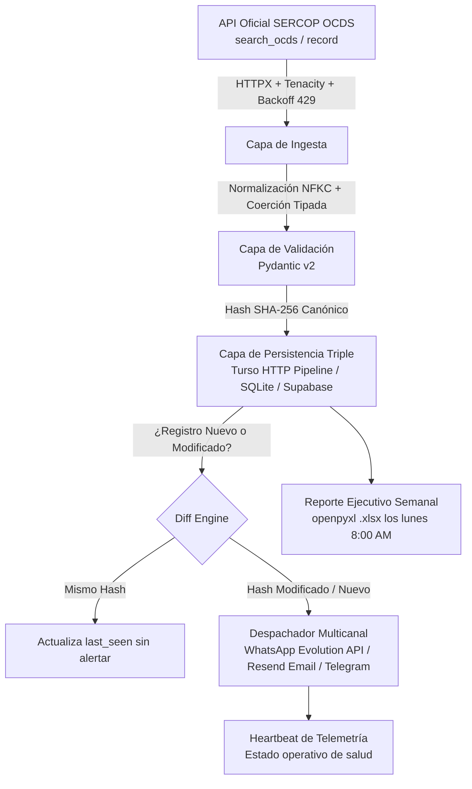

# LicitaciónYa — Pipeline de Monitoreo de Compras Públicas (SERCOP Ecuador)

Arquitectura de inteligencia de datos profesional y resiliente para el monitoreo de contrataciones estatales con ciclos automáticos de auditoría cada seis horas y costo operativo de **$0–$3/mes**, orientada al modelo **Intelligence as a Service (B2B)** bajo la marca comercial **LicitaciónYa**.

---

## 🏗️ Arquitectura del Sistema (5 Capas)



---

## 💼 Paquete Comercial "LicitaciónYa" (Semana 4)

El proyecto incluye la documentación y activos completos para comercializar el servicio a distribuidores ferreteros, importadoras y constructoras en Ecuador ($80/mes + IVA, sin costo de setup):

* 📄 **[Propuesta Comercial B2B](docs/propuesta_comercial.md):** One-pager de venta con desglose de dolor, entregables, pricing, piloto de 15 días gratis, SLA de 24h y checklist de demo en vivo.
* 🎯 **[Guion de Ventas y Cierre](docs/guion_venta.md):** 5 preguntas de discovery comercial, manejo de las 3 objeciones típicas ("no tengo tiempo", "¿es legal?", "¿por qué pagar si SERCOP es público?") y secuencias de WhatsApp con Excel en mano.
* ⚖️ **[Contrato de Servicio](docs/contrato_servicio.md):** Modelo legal con alcance, facturación SRI, exclusión de garantías sobre el Estado, confidencialidad y cumplimiento con la Ley Orgánica de Protección de Datos Personales (LOPD Ecuador).
* 📋 **[Directorio de 20 Prospectos](docs/lista_prospectos.md):** Empresas clave del rubro en Quito, Guayaquil, Cuenca, Ambato, etc., y la técnica maestra de minar oferentes y participantes directamente desde la base de Turso.
* 🌐 **[Landing Page Oficial](landing/index.html):** One-pager web moderno con diseño dark luxury, vista previa de alertas de WhatsApp y Excel gerencial, botón con mensaje precargado (`wa.me`) y FAQ.

---

## 📁 Estructura del Repositorio

```
D:\PROYECTOS\SCRAPING\
├── .github/
│   └── workflows/
│       ├── sercop.yml             # Monitoreo cada 6h (cron: '17 */6 * * *') + keepalive gh CLI
│       └── reporte_semanal.yml    # Generación y despacho de Excel cada lunes a las 8:00 AM (UTC-5)
├── config/
│   └── rubros.yaml                # Diccionario de 30+ keywords y umbrales por sector
├── docs/
│   ├── propuesta_comercial.md     # One-pager B2B vendible
│   ├── guion_venta.md             # Guion de cierre y objeciones
│   ├── contrato_servicio.md       # Contrato de prestación de servicios
│   └── lista_prospectos.md        # 20 prospectos clave + minado en SERCOP
├── landing/
│   ├── index.html                 # One-pager de ventas (Cloudflare Pages)
│   └── styles.css                 # Diseño CSS moderno (dark mode, glassmorphism)
├── src/
│   ├── client.py                  # Cliente HTTPX con backoff dinámico en HTTP 429
│   ├── models.py                  # Esquemas Pydantic v2 tolerantes a nulos
│   ├── transform.py               # Normalización NFKC y hashing SHA-256
│   ├── storage.py                 # Fábrica: TursoStorage (HTTP pipeline), SqliteStorage, SupabaseStorage
│   ├── matcher.py                 # Emparejamiento por keywords, montos y provincias
│   ├── notify.py                  # Multicanal: Resend (Email), Evolution API (WhatsApp), Telegram
│   ├── reporte.py                 # Generador Excel (.xlsx) con estilos y flag --demo
│   └── main.py                    # CLI con rotación de keywords (4 ciclos diarios de 6h)
├── scripts/
│   ├── descubre_params_v2.py      # Sondeo y descubrimiento empírico de la API SERCOP
│   └── migra_sqlite_turso.py      # Migrador por lotes SQLite -> Turso Cloud
└── tests/
    └── test_sercop.py             # 9 pruebas unitarias automatizadas (pytest)
```

---

## 🚀 Puesta en Marcha Rápida

### 1. Activar entorno virtual e instalar dependencias
```powershell
.\.venv\Scripts\Activate.ps1
pip install -r requirements.txt
```

### 2. Ejecutar la suite de pruebas unitarias
```powershell
pytest -v
```

### 3. Ejecutar el pipeline de extracción
```powershell
# Extrae y rota keywords según la hora UTC actual (o forzar con --ciclo 0..3):
python -m src.main --rubro ferreteria_construccion --pages 1
```

### 4. Generar el Reporte Ejecutivo en Excel (.xlsx)
```powershell
# Modo producción (solo oportunidades reales detectadas en los últimos 7 días):
python -m src.reporte --rubro ferreteria_construccion --dias 7

# Modo demostración comercial (para reuniones de venta con prospectos):
python -m src.reporte --rubro ferreteria_construccion --demo
```

---

## 🌐 Despliegue de la Landing en Cloudflare Pages ($0/mes)

La landing page ubicada en [`landing/`](file:///d:/PROYECTOS/SCRAPING/landing) no requiere compilación ni Node.js:

1. Crea una cuenta gratuita en [Cloudflare Dashboard](https://dash.cloudflare.com).
2. Ve a **Compute (Workers & Pages)** &rarr; **Create application** &rarr; pestaña **Pages**.
3. Selecciona **Connect to Git** y vincula el repositorio `joelsan12/SCRAPING`.
4. Configuración del proyecto de compilación:
   * **Project name:** `licitacionya`
   * **Production branch:** `main`
   * **Framework preset:** `None`
   * **Build command:** *(dejar vacío)*
   * **Build output directory:** `landing`
5. Haz clic en **Save and Deploy**.
6. En 30 segundos tu landing estará en línea con HTTPS y CDN global en:
   `https://licitacionya.pages.dev`

---

## 🔐 Configuración de Secretos en GitHub Actions

En tu repositorio de GitHub (**Settings → Secrets and variables → Actions**), configura:

| Secreto | Descripción | Obligatorio |
| :--- | :--- | :---: |
| `STORAGE_BACKEND` | `turso` (por defecto) o `supabase` | Sí |
| `TURSO_DATABASE_URL` | URL de tu base Turso (`libsql://...turso.io`) | Sí |
| `TURSO_AUTH_TOKEN` | Token JWT de autenticación Turso | Sí |
| `TELEGRAM_BOT_TOKEN` | Token de Telegram Bot Father para alertas | Opcional |
| `TELEGRAM_CHAT_ID` | Chat ID de Telegram para recibir alertas | Opcional |
| `RESEND_API_KEY` | API Key de [Resend.com](https://resend.com) | Para Email |
| `RESEND_TO_EMAIL` | Correo del cliente que recibe el Excel semanal | Para Email |
| `EVOLUTION_API_URL` | URL del contenedor Evolution API (WhatsApp) | Para WhatsApp |
| `EVOLUTION_API_KEY` | Clave API de Evolution API | Para WhatsApp |
| `EVOLUTION_INSTANCE_NAME`| Nombre de instancia vinculada al número emisor | Para WhatsApp |
| `EVOLUTION_TARGET_NUMBER`| Teléfono del cliente con código de país (`593...`) | Para WhatsApp |

Los workflows de GitHub Actions vigilarán SERCOP cada 6 horas (`sercop.yml`) y entregarán el Excel cada lunes (`reporte_semanal.yml`) de forma 100% automática y desatendida.
