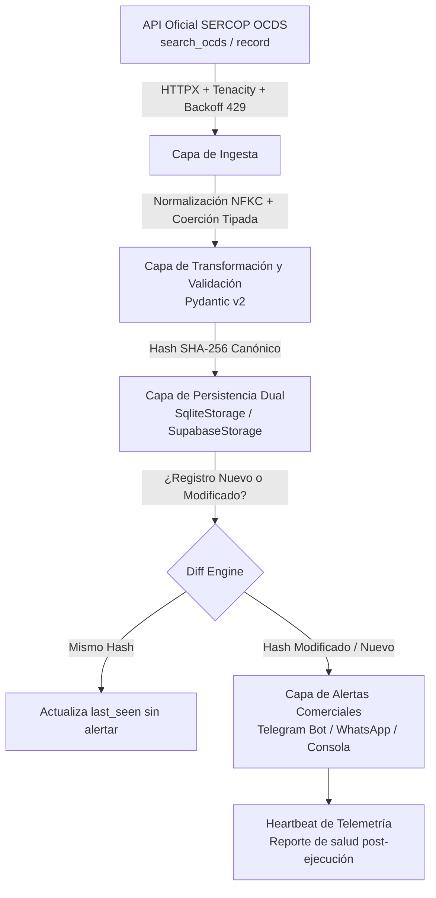

# Pipeline de Extracción y Monitoreo de Compras Públicas (SERCOP Ecuador)

Arquitectura de datos profesional y resiliente para monitoreo de contrataciones estatales en tiempo real con costo operativo de **$0/mes**, orientada al modelo **Intelligence as a Service (B2B)**.

---

## 🏗️ Arquitectura del Sistema (4 Capas)



---

## 📁 Estructura del Proyecto

```
D:\PROYECTOS\SCRAPING\
├── .github/
│   └── workflows/
│       └── sercop.yml        # Workflow GitHub Actions: cron cada 6h + keepalive anti-60 días
├── .env.example              # Plantilla de variables de entorno (Telegram, Supabase)
├── .gitignore                # Protección estricta de credenciales y datos
├── requirements.txt          # Dependencias (httpx, pydantic, tenacity, supabase, pytest)
├── pytest.ini                # Configuración de pruebas
├── config/
│   └── rubros.yaml           # Diccionario de keywords y umbrales por sector
├── src/
│   ├── client.py             # Cliente HTTPX con backoff, jitter y manejo de Retry-After (429)
│   ├── models.py             # Esquemas Pydantic v2 con validación tolerante a nulos
│   ├── transform.py          # Normalización Unicode NFKC, hashing SHA-256 y cálculo de variación %
│   ├── storage.py            # Persistencia dual: SqliteStorage (local) y SupabaseStorage (cloud)
│   ├── matcher.py            # Motor de coincidencia por palabras clave, montos y regiones
│   ├── notify.py             # Despachador de alertas Telegram y Heartbeat de telemetría
│   └── main.py               # Orquestador CLI con año dinámico y telemetría
├── scripts/
│   ├── descubre_params.py    # Sondeo empírico de la API oficial de SERCOP
│   ├── descubre_params_v2.py # Validación de parámetros 'year', 'search' y detalle 'record'
│   ├── backfill_csv.py       # Carga masiva histórica desde archivos CSV
│   └── migra_sqlite_supabase.py # Migración de historial SQLite -> Supabase
├── supabase/
│   └── schema.sql            # DDL PostgreSQL para Supabase (tablas, índices, RLS)
└── tests/
    └── test_sercop.py        # Suite de pruebas unitarias automatizadas (7 tests)
```

---

## 🚀 Puesta en Marcha Rápida

### 1. Activar el entorno virtual e instalar dependencias
```powershell
.\.venv\Scripts\Activate.ps1
pip install -r requirements.txt
```

### 2. Ejecutar la suite de pruebas unitarias
```powershell
.\.venv\Scripts\python.exe -m pytest -v
```

### 3. Ejecutar el pipeline localmente (Persistencia SQLite)
```powershell
# Búsqueda por rubro de Ferretería y Construcción:
.\.venv\Scripts\python.exe -m src.main --rubro ferreteria_construccion --pages 1 --keywords cemento
```

---

## ☁️ Configuración para Producción (Supabase + GitHub Actions)

### 1. Crear las tablas en Supabase
1. Ingresa a tu proyecto en [Supabase](https://supabase.com).
2. Ve al **SQL Editor**.
3. Pega y ejecuta el contenido de [`supabase/schema.sql`](file:///d:/PROYECTOS/SCRAPING/supabase/schema.sql).

### 2. Migrar historial local a Supabase (opcional para no duplicar alertas)
```powershell
# Configura SUPABASE_URL y SUPABASE_KEY en tu .env y ejecuta:
.\.venv\Scripts\python.exe scripts/migra_sqlite_supabase.py
```

### 3. Configurar GitHub Actions (Repo Privado)
En tu repositorio de GitHub, ve a **Settings → Secrets and variables → Actions** y añade:
* `SUPABASE_URL`: URL de tu proyecto Supabase (ej. `https://xyz.supabase.co`).
* `SUPABASE_KEY`: Tu API key `anon` o `service_role`.
* `STORAGE_BACKEND`: `supabase`
* `TELEGRAM_BOT_TOKEN`: Token de tu bot de Telegram.
* `TELEGRAM_CHAT_ID`: ID del chat o canal de Telegram.

El workflow se ejecutará automáticamente cada 6 horas (`cron: '17 */6 * * *'`), enviará las alertas de compras públicas y emitirá un **Heartbeat** con el resumen operativo.
